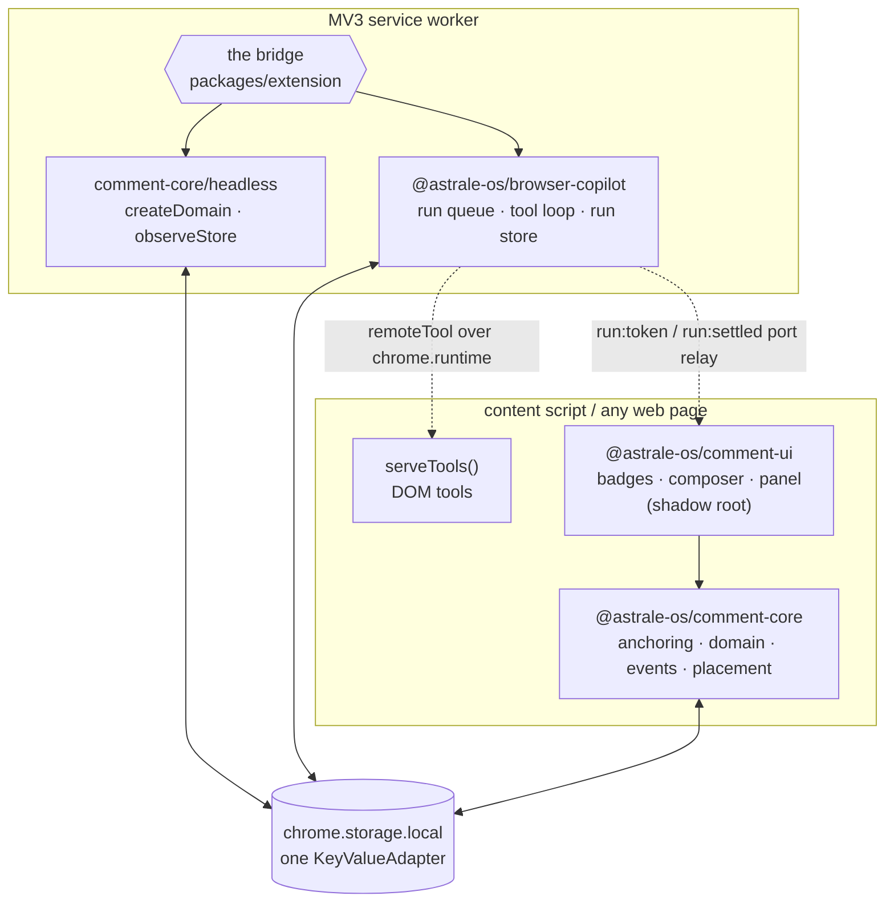

# exp-spec

**Anchored comment threads on any web page, with an LLM copilot replying in the threads.**

Built as **two libraries that know nothing about each other**, plus a Chrome extension whose
only job is to introduce them.

| Module | Package | What it is on its own |
|---|---|---|
| **Comment engine** | [`@astrale-os/comment-core`](packages/comment-core) + [`@astrale-os/comment-ui`](packages/comment-ui) | Persistent, re-anchorable comment threads on any element of any HTML page: flat replies, resolve/reopen, robust to dynamic DOM. No extension, no AI, no server. |
| **Copilot** | [`@astrale-os/browser-copilot`](packages/copilot) | A generic browser LLM agent runtime: trigger/listen, host-registered typed tools, a durable run queue that survives service-worker death. Zero knowledge of comments. |

That separation is not an aesthetic preference — it is the load-bearing constraint of the whole
repo. Both libraries must make sense published standalone on npm, so anything that needs both
halves lives in the extension (or in the demo's tiny glue).

---

## Architecture



<details>
<summary>Same picture, as plain text</summary>

```
        content script / any page              MV3 service worker
     ┌────────────────────────────┐        ┌────────────────────────────┐
     │  comment-ui  ──▶ comment-core        │  extension  ──▶ comment-core/headless
     │  (shadow root)      │      │        │  (the bridge)  ──▶ browser-copilot
     │  serveTools() ◀╌╌╌╌╌│╌╌╌╌╌╌│╌╌╌╌╌╌╌╌│╌╌ remoteTool over chrome.runtime
     └─────────────────────│──────┘        └───────────│────────────────┘
                           │                           │
                           └────────┬──────────────────┘
                                    ▼
                     chrome.storage.local — one KeyValueAdapter
              exp-spec:*  ·  runs:*  ·  exp-spec:host:*   (disjoint ranges)
```

</details>

The dependency rule, which the definition-of-done enforces by grep:

```
extension       → { comment-core, comment-ui, browser-copilot }
comment-ui      → comment-core
comment-core    → nothing internal      ← never imports the copilot
browser-copilot → nothing internal      ← never imports comment-core
```

Neither library ever names a platform. `chrome.storage` reaches them as a `KeyValueAdapter`;
`chrome.runtime` reaches the copilot as a one-method `ToolTransport`; MV3 keepalive is two
events the host binds. `grep -rE "chrome\.|wxt/" packages/comment-core/src packages/copilot/src`
returns nothing.

### The two seams that carry the bridge

1. **One shared `KeyValueAdapter`, three disjoint key ranges.** `exp-spec:*` (threads and
   comments, owned by `comment-core`), `runs:*` (run records and leases, owned by the copilot),
   `exp-spec:host:*` (pending-dispatch set, thread→run index, observe cursors, unread — owned by
   the bridge). Each store filters `watch` to its own prefix, so the three ranges never wake
   each other.
2. **`observeStore`** — the service worker learns about `thread:create` / `thread:reply` by
   diffing the same store, with a *durable* cursor. `chrome.storage.onChanged` wakes a dormant
   worker, so the write that caused the wake happened before the worker existed; an in-memory
   baseline would never see it. Messaging survives only for the genuinely irreducible case: DOM
   tools that must run in the page.

---

## Repository map

```
exp-spec/
├── packages/
│   ├── comment-core/    # headless engine: anchoring, domain, stores, events, placement
│   ├── comment-ui/      # badges + composer + thread popover + panel, in one shadow root
│   ├── copilot/         # @astrale-os/browser-copilot — the generic agent runtime
│   └── extension/       # MV3 extension (WXT) — THE bridge, the only place both are imported
├── apps/
│   └── demo/            # static pages loading the IIFE bundles via <script> — no extension
├── bench/               # agent-browser scenarios + site corpus for anchoring robustness (M2)
└── docs/
    ├── SPEC-comment-core.md   # locked implementation contract for modules 1 + 2
    └── SPEC-copilot.md        # locked implementation contract for module 3
```

`PLAN.md` is the design document the specs were converged from. The two `docs/SPEC-*.md` files
are **normative**: every export, signature, default, ordering rule and error path in them is the
contract the code is tested against. If something looks underspecified there, that is a spec
bug — fix the spec, then the code.

---

## Getting started

```sh
pnpm install          # ALWAYS at the workspace root, never in a subpackage
pnpm build            # all packages: ESM + IIFE + .d.ts
```

### The gate

Run all three before you call anything done.

```sh
pnpm lint             # oxlint
pnpm typecheck        # tsgo --noEmit, recursive
pnpm test             # vitest run, recursive
```

```sh
pnpm format           # oxfmt --write . — only before committing
pnpm format:check     # oxfmt --check .
```

Never `prettier`, `eslint` or `tsc`. See [CONTRIBUTING.md](CONTRIBUTING.md).

### Run the demo

Six static pages, served off disk, that exercise the anchoring scenarios that actually break
things — list reorder, popover unmount/remount, infinite scroll, SPA route change, attribute
churn. No bundler, no extension, no service worker, no model: the "copilot" is an echo responder
built from a `setTimeout` and one `engine.appendComment({ author: 'copilot' })`.

```sh
pnpm --filter exp-spec-demo start     # build + serve on http://localhost:4173
# or, separately:
pnpm --filter exp-spec-demo build     # → apps/demo/dist (self-contained; drop it on any static host)
pnpm --filter exp-spec-demo serve
```

On every page: <kbd>C</kbd> places a comment, <kbd>A</kbd> asks, <kbd>Esc</kbd> backs out, and
the corner panel lists open, resolved and unanchored threads. Threads live in `localStorage`,
keyed by page URL.

If the demo works, module 1 works. Each page loads exactly two script tags —
`comment-core.iife.js` then `comment-ui.iife.js`, in that order, because `comment-ui` reads
`comment-core` off `globalThis.Comments`.

### Develop the extension

```sh
pnpm --filter exp-spec-extension dev      # WXT dev server
pnpm --filter exp-spec-extension build    # → packages/extension/.output/chrome-mv3
```

Then in Chrome: `chrome://extensions` → enable **Developer mode** → **Load unpacked** →
`packages/extension/.output/chrome-mv3`. Open the extension's options page and paste an
Anthropic API key; the model tier, per-mode system prompts, per-mode dispatch policy
(`immediate` / `manual`) and the two trigger keys are configured there too.

The manifest asks for `storage`, `alarms`, `unlimitedStorage` and `tabs`, plus
`host_permissions` on `https://api.anthropic.com/*` — extension-context requests to a host in
`host_permissions` bypass CORS, so there is no proxy server. `chrome.commands` cannot bind a
bare letter, so <kbd>Alt+Shift+C</kbd> / <kbd>Alt+Shift+A</kbd> are the backup path into the
same `engine.startPlacement(kind)` the page's own key listener uses.

Internal tool. Not intended for Chrome Web Store publication.

---

## Documentation

| Read this | For |
|---|---|
| [`packages/comment-core/README.md`](packages/comment-core/README.md) | The comment engine: anchoring model, lifecycle, stores, events, headless/SW usage, custom strategies. |
| [`packages/comment-ui/README.md`](packages/comment-ui/README.md) | Mounting, the CSS custom-property theming contract, `decorate()` recipes, accessibility. |
| [`packages/copilot/README.md`](packages/copilot/README.md) | The agent runtime: typed tools, run lifecycle, MV3 survival, run stores, error taxonomy. |
| [`docs/SPEC-comment-core.md`](docs/SPEC-comment-core.md) | The normative contract, including the edge-case table and every ordering rule. |
| [`docs/SPEC-copilot.md`](docs/SPEC-copilot.md) | The normative contract for the runtime, including the decision log. |
| [`CONTRIBUTING.md`](CONTRIBUTING.md) | Tooling, dependency rules, and the TDD-from-spec workflow. |

---

## License

Apache-2.0 © Astrale. Vendored Hypothesis `annotator/anchoring` sources under
`packages/comment-core/src/anchor/vendor/hypothesis/` are BSD-2-Clause.
