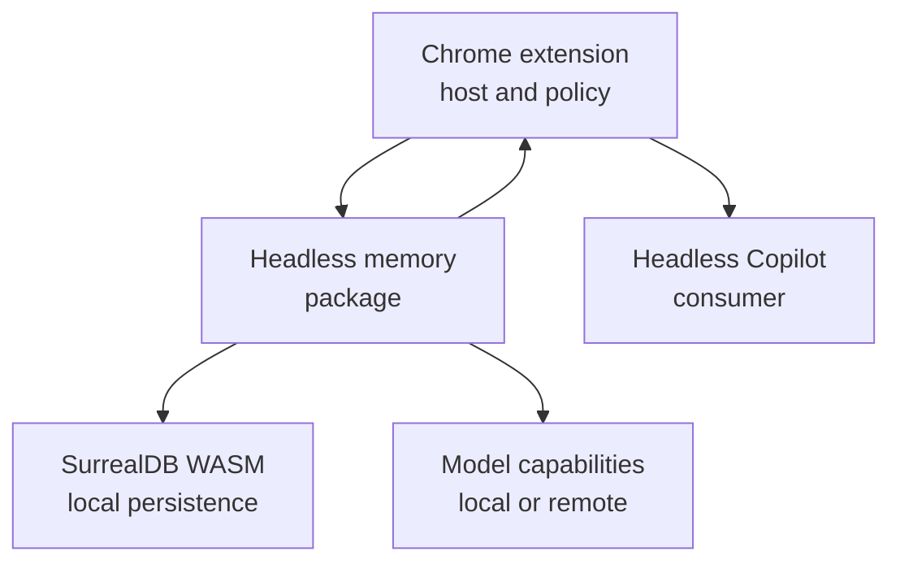
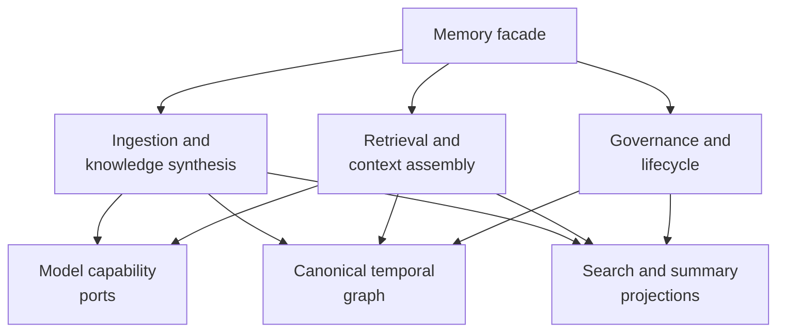
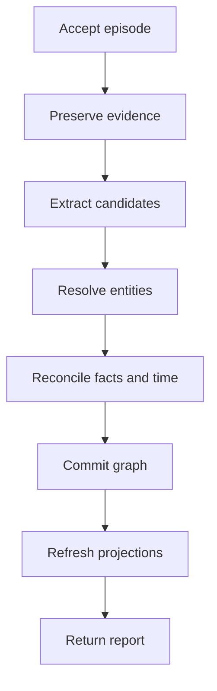

# Headless Temporal Graph Memory

## Product and Architecture Specification

| Field | Value |
| --- | --- |
| Status | Proposed specification |
| Version | 0.1 |
| Date | 2026-08-03 |
| Audience | Product, architecture, engineering, security, and future integrators |
| Primary runtime | Browser-compatible JavaScript/TypeScript |
| Reference persistence | Embedded SurrealDB WebAssembly with IndexedDB persistence |
| Primary consumers | Chrome extension orchestration layer and headless Copilot module |

## 1. Purpose

This document specifies a headless, local-first memory package for AI applications. The package incrementally transforms interactions and other source material into a temporal knowledge graph, then retrieves relevant, explainable context for downstream consumers.

The product is inspired by Graphiti's context-graph model: immutable source episodes, resolved entities, temporal facts, provenance, incremental graph construction, and hybrid retrieval. It is an independent design rather than a browser port or compatibility layer for Graphiti.

The first deployment target is a Chrome extension, but the memory package must remain independent of Chrome. The extension will host and orchestrate the package, connect it to browser activity, provide model capabilities and user policy, and pass retrieved context to a separate headless Copilot module.

This specification establishes product semantics, system boundaries, conceptual architecture, required capabilities, quality properties, and acceptance criteria. Detailed schemas, TypeScript interfaces, SurrealQL, prompt design, algorithms, and package layout belong to subsequent design specifications.

The as-built alpha contract and exact public boundaries are maintained in
`docs/SPEC-temporal-memory.md`; `docs/PRODUCT-temporal-memory.md` records the current product
interpretation and production gates. Where this proposed baseline is broader or older, those later
documents govern the implementation.

### 1.1 Normative language

The terms **MUST**, **MUST NOT**, **SHOULD**, **SHOULD NOT**, and **MAY** describe requirement strength.

## 2. Executive summary

The memory package must provide a durable, evolving representation of what has been observed, what has been inferred, when each claim applied, and which evidence supports it.

Its core loop is:

1. Accept a normalized source episode.
2. Preserve the episode as evidence.
3. Extract candidate entities, facts, temporal information, and types.
4. Resolve candidates against existing knowledge.
5. Reconcile additions, repetitions, corrections, and contradictions.
6. Persist the resulting temporal graph and rebuildable search projections.
7. Retrieve relevant context through semantic, lexical, graph, temporal, and deterministic filters.
8. Return structured results with provenance and explanations to the consumer.

All durable memory is stored locally in the browser through embedded SurrealDB WASM and IndexedDB. Remote LLM, embedding, or reranking services may be used through injected capability providers. The system must make this network boundary explicit because local persistence does not imply that all processed content remains on-device.

The package owns memory semantics and the transport-neutral checkpoint/reconciliation protocol. It
does not own browser capture, extension permissions, UI, conversational orchestration, agent
behavior, credential management, peer discovery, network transport, authentication, or cloud sync
topology.

## 3. Product context and boundaries

### 3.1 System context

The extension is expected to call memory operations, deliver their results to the Copilot, and decide when browser-derived information should be remembered. The Copilot must consume memory through the public memory contract or through context assembled by the extension. Neither consumer may depend on the physical database model.

### 3.2 Responsibility allocation

| Concern | Memory package | Chrome extension | Copilot module | Model provider |
| --- | --- | --- | --- | --- |
| Episode semantics and validation | Owns | Supplies normalized input | May propose input | None |
| Browser capture and cross-domain access | None | Owns | None | None |
| User consent and site policy | Enforces supplied scope | Owns policy decision | Respects result | None |
| Entity and fact extraction | Orchestrates | Supplies provider | None | Executes requested inference |
| Entity resolution and temporal reconciliation | Owns | Configures policy | None | May assist |
| Durable graph and search projections | Owns | Hosts runtime | No direct access | None |
| Retrieval and context assembly | Owns | Calls and routes | Consumes | May embed or rerank |
| Conversation and working context | None | Coordinates | Owns | None |
| Tool use and agent actions | None | Coordinates | Owns | None |
| API credentials | Never owns by default | Owns | None | Validates |
| Export, import, and local reset UI | Provides capabilities | Owns UX | None | None |
| Cross-device sync | Owns portable checkpoints, validation, and reconciliation | Owns transport, authentication, topology, and policy | None | None |

### 3.3 Definition of headless

The package MUST:

- expose a programmatic API with no required user interface;
- avoid dependencies on DOM state, tabs, Chrome APIs, extension manifests, or a particular UI framework;
- support explicit lifecycle management by its host;
- accept dependencies and policy through configuration rather than global application state;
- avoid requiring an HTTP server or separate database process;
- remain usable from a browser worker-compatible environment;
- remain independently testable through a neutral harness;
- avoid importing or depending on the Copilot package.

The host MAY wrap the package in extension messages, an offscreen document, a dedicated worker, a web application, or another browser-compatible execution environment.

## 4. Goals

### 4.1 Primary goals

The system MUST:

1. Provide durable long-term memory for an AI Copilot or agent.
2. Run locally in a browser without an application server or database server.
3. Build knowledge incrementally from text, messages, events, and structured data.
4. Represent stable entities and temporal claims instead of storing only flat chunks.
5. Preserve the source evidence and provenance behind derived knowledge.
6. Distinguish current knowledge from historical knowledge.
7. Handle repeated, evolving, and contradictory information without destructive overwrites.
8. Retrieve context through a configurable combination of exact filters, lexical search, vector similarity, graph structure, time, recency, and optional reranking.
9. Return structured, attributable results suitable for a headless Copilot.
10. Support prescribed domain types while remaining useful with an open, evolving ontology.
11. Permit remote model APIs while keeping durable memory local.
12. Remain configurable across model providers, retrieval policies, memory spaces, and domain ontologies.
13. Support inspection, correction, forgetting, export, import, and graph maintenance.
14. Remain resilient to browser lifecycle interruption and transient model failures.

### 4.2 Secondary goals

The system SHOULD:

- minimize unnecessary model calls and transmitted data;
- make derived projections replaceable when models or ranking strategies change;
- expose enough evidence for users and developers to understand a recalled result;
- offer sensible defaults while allowing advanced configuration;
- preserve deterministic behavior whenever model judgment is unnecessary;
- support future storage or runtime evolution without exposing those choices publicly.

## 5. Non-goals

The initial product is not responsible for:

- browser page capture, DOM interpretation, or cross-domain permissions;
- a Chrome extension, side panel, popup, or other UI;
- conversational state machines, prompt orchestration, planning, or tool execution;
- a general-purpose knowledge graph database API for application consumers;
- exposing SurrealQL or physical database records through the scoped `Memory` facade; a trusted host
  may explicitly opt into the separate confirmed/bounded Surreal adapter escape hatch and assumes
  responsibility for bypassed invariants;
- a generic RAG document ingestion platform for large file repositories;
- collaborative multi-user memory or server-side tenancy;
- a built-in cross-device transport, account service, peer-discovery system, or cloud-backup product;
- training, fine-tuning, or hosting foundation models;
- deciding whether a browser observation may legally or ethically be stored;
- independently authenticating end users or authorizing browser origins;
- claiming objective truth for model-derived facts;
- complete compatibility with Graphiti's APIs, storage model, prompts, or behavior.

Short-lived conversational working memory remains the responsibility of the Copilot. The memory package may persist conversation episodes, but it does not own the live dialogue state.

## 6. Design principles

### 6.1 Evidence before interpretation

Original episodes are evidence. Entities, facts, summaries, and classifications are interpretations derived from that evidence. The system MUST preserve this distinction.

### 6.2 Claims rather than truth

A stored fact is a claim supported by one or more sources. Its existence does not certify that it is universally true. Results MUST retain provenance and, when relevant, conflict state.

### 6.3 Temporal history is first-class

New information may end the validity of an earlier claim, but MUST NOT erase the historical claim merely because it is no longer current.

### 6.4 Incremental evolution

New episodes MUST integrate with existing knowledge without requiring full graph reconstruction. Full rebuilds MAY remain available for recovery, migration, or quality improvements.

### 6.5 Local-first durability

Durable memory belongs to the local browser profile by default. Network services are optional computation dependencies, not the authoritative memory store.

### 6.6 Structured core, replaceable projections

Canonical episodes, identities, claims, temporal intervals, and provenance form the durable core. Embeddings, summaries, lexical indexes, ranking features, and context renderings are derived projections that MUST be replaceable.

### 6.7 Explicit boundaries

All calls that may transmit content outside the local runtime MUST pass through declared provider capabilities and observable policy hooks.

### 6.8 Explainability by construction

Every recalled claim SHOULD be traceable to evidence and accompanied by enough ranking and filtering information to explain its inclusion.

### 6.9 Reversible automation

Model-driven entity merges, fact invalidations, and type assignments SHOULD be auditable and reversible whenever practical. Destructive actions require explicit semantics.

### 6.10 Capability-oriented extensibility

Extensibility SHOULD occur through cohesive capabilities such as inference, embeddings, reranking, ontology, and policy. The design SHOULD avoid a proliferation of shallow abstractions that merely mirror internal functions.

## 7. Conceptual domain model

### 7.1 Memory space

A **memory space** is the top-level isolation and lifecycle boundary for a coherent body of memory. Every stored and retrieved object MUST belong to exactly one memory space.

A space may represent a user, profile, workspace, organization, project, or another host-defined context. The package enforces isolation between spaces but does not decide who is authorized to enter a space.

### 7.2 Episode

An **episode** is an immutable unit of source evidence accepted by the memory system. Examples include:

- a user or assistant message;
- a selected passage from a web page;
- a normalized browser event;
- an email or calendar record supplied by the host;
- a structured business object;
- an explicit user correction;
- a host-generated observation.

An episode conceptually contains:

- a stable identity or host-provided idempotency key;
- its memory space and access scope;
- source kind and source reference;
- original or normalized content;
- the time described or observed, when known;
- the time received by memory;
- provenance metadata such as origin, URL, thread, author, or external record identifier;
- sensitivity, retention, tags, and host-defined metadata;
- processing status and diagnostic history.

Episodes MUST remain available as the evidence layer unless explicitly purged by policy. Their content MUST NOT be silently rewritten after derived knowledge has been created.

### 7.3 Entity

An **entity** represents a persistent identity inferred or declared across episodes, such as a person, organization, product, place, project, preference subject, document, or concept.

An entity conceptually contains:

- a stable internal identity;
- one or more types;
- canonical display information;
- aliases and identifiers;
- references to mentions and supporting episodes;
- optional derived summary and embedding projections;
- merge, split, correction, and lifecycle history.

Entities SHOULD carry only identity-level canonical data. Evolving knowledge about an entity SHOULD be represented as temporal facts, allowing prior states to remain recoverable. Summaries are derived views and MUST NOT be the sole store of knowledge.

### 7.4 Fact

A **fact** is a temporal claim connecting a subject to an object through a predicate. The object may be another entity or a scalar value.

Examples include:

- `Person A works_at Company B`;
- `User prefers concise_answers`;
- `Project has_status active`;
- `Meeting occurs_at 2026-08-10T10:00Z`.

A fact conceptually contains:

- subject, predicate, and object;
- optional prescribed fact type;
- memory space and access scope;
- valid-time interval;
- system record-time information;
- status such as active, superseded, disputed, retracted, or deleted;
- supporting and contradicting evidence;
- extraction and reconciliation provenance;
- optional confidence or quality signals;
- optional derived text and embedding projections.

Facts MUST be independently addressable and MUST preserve their historical lifecycle.

### 7.5 Evidence link

An **evidence link** records how an episode supports, contradicts, corrects, or mentions an entity or fact. Every model-derived fact MUST have at least one evidence link.

Evidence links permit:

- attribution of recalled context;
- reassessment after an episode is removed;
- multiple independent sources for one claim;
- conflict representation;
- reprocessing after model or ontology changes.

### 7.6 Mention

A **mention** is an occurrence of a possible entity or fact in a particular episode. Mentions preserve the distinction between source-local wording and resolved canonical identity.

Mentions MAY be explicit durable records or an equivalent durable relationship. The conceptual capability is required even if the physical representation differs.

### 7.7 Ontology

An **ontology** describes permitted or preferred entity types, fact types, attributes, constraints, descriptions, and extraction guidance.

The system MUST support:

- a default open ontology suitable for general memory;
- prescribed host-defined types;
- unknown or unclassified entities and facts when policy permits;
- ontology versioning;
- validation that is distinct from model extraction;
- migration or reinterpretation when an ontology evolves.

Ontology definitions are developer-controlled data. A model MAY propose classifications or extensions but MUST NOT silently mutate a prescribed ontology.

### 7.8 Derived projection

A **derived projection** improves access to canonical memory but may be recomputed. Examples include:

- embeddings;
- lexical search documents;
- entity summaries;
- fact renderings;
- adjacency or ranking features;
- community summaries;
- cached context bundles.

Every projection MUST record enough lineage or version information to determine whether it is current. Loss of a projection MUST NOT destroy canonical memory.

### 7.9 Processing operation

A **processing operation** represents an ingestion, reprocessing, migration, deletion, export, import, or maintenance attempt. Operations provide status, diagnostics, accounting, and recovery without making transient in-memory state authoritative.

## 8. Semantic invariants

The following invariants define correct system behavior:

1. Every canonical record belongs to one memory space.
2. An episode is immutable after acceptance, except for retention state or hard purge.
3. Every derived fact is traceable to at least one episode or explicit host assertion.
4. A current view is derived from active facts, not destructive mutation of history.
5. Superseding a claim preserves the superseded claim and its evidence.
6. Reprocessing the same episode with the same idempotency identity does not duplicate canonical knowledge.
7. Entity resolution does not destroy mention-level provenance.
8. Entity merges are traceable; reversible merges SHOULD be supported.
9. Search scores do not become truth confidence.
10. Projections can be rebuilt from canonical records and declared provider versions.
11. Retrieval never crosses a memory-space boundary.
12. Scope filters are applied before results leave the package.
13. Removal of one episode does not remove a fact still supported by another retained episode.
14. Hard purge removes the targeted canonical content and any projections that would reveal it.

## 9. Temporal model

### 9.1 Time dimensions

The system MUST distinguish at least:

- **valid time**: when a claim applies in the represented world;
- **record time**: when the memory system learned, stored, changed, or retracted the claim.

Episode occurrence time and ingestion time are therefore distinct. A message received today may describe a fact that became true months earlier. A correction received later may revise what the system believes about that earlier interval.

### 9.2 Open and closed intervals

A fact may have:

- a known start and unknown end;
- known start and end;
- unknown start and known end;
- an unknown validity interval;
- several non-contiguous historical occurrences represented as separate claim instances or revisions.

Unknown temporal information MUST remain unknown. The system MUST NOT invent precise timestamps solely to satisfy storage constraints.

### 9.3 Current and historical views

The system MUST support:

- the best current view;
- an `as of` valid-time view;
- an `as known at` record-time view when retained history permits it;
- a full history view including superseded, disputed, and retracted claims.

### 9.4 Supersession and contradiction

The system MUST distinguish:

- repetition of the same claim;
- an additive fact that may coexist;
- a temporal replacement;
- an explicit correction;
- a genuine unresolved conflict;
- a source retraction;
- uncertainty caused by incomplete information.

Semantic similarity alone is insufficient to invalidate an existing fact. Reconciliation must consider predicate semantics, cardinality or ontology constraints, source time, evidence quality, and explicit correction signals.

### 9.5 Entity evolution

Mutable entity attributes SHOULD be represented as facts or equivalent temporal claims. A derived current profile may expose convenient attributes, but it MUST remain possible to reconstruct prior supported states.

## 10. High-level architecture

### 10.1 Memory facade

The facade is the only supported entry point for consumers. It MUST:

- expose lifecycle, ingestion, retrieval, inspection, correction, deletion, import, export, and maintenance capabilities;
- validate space and scope context;
- isolate consumers from database and model-provider details;
- provide operation status and diagnostics;
- support cancellation and bounded execution where the host can provide them.

The public contract should favor domain concepts such as episodes, facts, entities, recall, and forgetting. Database commands and model prompts are internal concerns.

### 10.2 Ingestion and knowledge synthesis

This subsystem owns:

- episode acceptance and idempotency;
- source normalization checks;
- retrieval of relevant existing context for interpretation;
- candidate entity, fact, type, and temporal extraction;
- entity resolution and deduplication;
- fact deduplication and temporal reconciliation;
- evidence linking;
- projection updates;
- processing reports and recoverable failures.

### 10.3 Retrieval and context assembly

This subsystem owns:

- query interpretation;
- deterministic filtering;
- candidate generation from multiple retrieval channels;
- score normalization and fusion;
- graph expansion;
- optional reranking;
- diversity, recency, temporal, and evidence policies;
- output budgeting;
- structured context assembly and provenance.

### 10.4 Governance and lifecycle

This subsystem owns:

- memory-space lifecycle;
- correction and retraction;
- forgetting and hard purge;
- retention and sensitivity enforcement supplied by the host;
- export and import;
- integrity checks;
- schema and projection migrations;
- reprocessing and re-indexing;
- compaction where it does not violate canonical history.

### 10.5 Canonical temporal graph

The canonical graph stores episodes, entities, facts, evidence relationships, temporal lifecycle, ontology identity, and space/scope boundaries. It is authoritative for memory semantics.

### 10.6 Search and summary projections

This layer stores replaceable structures needed for lexical retrieval, vector retrieval, ranking, summaries, and other accelerators. It MUST remain version-aware and rebuildable.

### 10.7 Model capability ports

Model capabilities are supplied by the host. The initial capability families are:

- structured inference for extraction, resolution assistance, reconciliation assistance, and optional summarization;
- embeddings for semantic retrieval;
- optional reranking or cross-encoding;
- optional deterministic local processors for known structured formats.

The memory package owns when and why these capabilities are invoked. Provider adapters own transport and provider-specific protocol.

## 11. Ingestion behavior

### 11.1 Accepted episode classes

The system SHOULD accept at least:

- plain text;
- conversational messages with role and thread metadata;
- structured JSON-like values;
- explicit facts or assertions supplied by a trusted host;
- corrections or retractions;
- normalized events.

Binary file parsing, page scraping, email access, and third-party connector behavior remain outside the package. The host converts those sources into normalized episodes.

### 11.2 Conceptual ingestion lifecycle

This is a semantic lifecycle, not a required transaction implementation. The following behavior is required:

- accepted evidence survives transient downstream failures;
- failed or partial processing can be inspected and retried;
- retries are idempotent;
- canonical updates become visible consistently;
- retrieval continues from the last coherent committed state;
- projection failure does not corrupt canonical memory;
- operation reports identify which stages completed.

### 11.3 Existing-context use

Extraction and resolution SHOULD consider relevant existing entities and facts. The system SHOULD use bounded, targeted context rather than sending the entire graph to a model.

### 11.4 Structured input

Structured inputs SHOULD preserve their original shape as evidence. When an explicit mapping or ontology can interpret the input deterministically, the system SHOULD avoid unnecessary LLM inference.

### 11.5 Host assertions

The host MAY submit explicit entities or facts. Such assertions MUST retain their declared source and trust class. They MAY bypass extraction but MUST still pass validation, scoping, temporal reconciliation, and provenance rules.

### 11.6 Processing report

An ingestion result SHOULD describe:

- episode identity and status;
- created, matched, merged, or updated entities;
- created, repeated, superseded, disputed, or rejected facts;
- unresolved candidates and warnings;
- model and projection work performed;
- retryability and diagnostics;
- privacy-relevant provider calls, without exposing credentials.

## 12. Entity resolution

Entity resolution determines whether a mention refers to an existing entity, a new entity, or an unresolved candidate.

The process SHOULD consider:

- exact identifiers and host-provided keys;
- ontology type compatibility;
- normalized names and aliases;
- nearby graph context;
- source and scope boundaries;
- temporal plausibility;
- lexical and semantic similarity;
- model judgment when deterministic evidence is insufficient.

The system MUST favor precision over aggressive merging. A false merge can contaminate many downstream facts, while an unmerged duplicate can be corrected later.

The system MUST support the conceptual outcomes:

- match an existing entity;
- create a new entity;
- retain an unresolved candidate;
- merge entities with an audit trail;
- split or undo an incorrect merge;
- attach a new alias or identifier;
- reject a candidate that violates policy or ontology.

Entity resolution decisions SHOULD retain their basis, model version when applicable, and confidence class. Numeric confidence MUST NOT be presented as calibrated probability unless it has been empirically calibrated.

## 13. Fact reconciliation and conflict handling

For each candidate fact, the system must determine its relationship to existing claims.

Possible outcomes include:

- create a new fact;
- attach additional evidence to an equivalent fact;
- extend or refine a validity interval;
- supersede a prior fact from a particular time;
- mark claims as disputed;
- retract a prior assertion;
- reject an unsupported or malformed candidate;
- defer the decision for later review.

### 13.1 Precedence

Reconciliation policy SHOULD be configurable and may consider:

- explicit user correction;
- trusted structured source;
- direct quotation or observed event;
- host assertion;
- model inference;
- source recency and valid time;
- independent corroboration;
- ontology cardinality or exclusivity constraints.

No global precedence rule can safely cover every domain. The default policy should be conservative, preserve conflicts, and avoid silently erasing evidence.

### 13.2 Correction

An explicit correction SHOULD create a traceable correction relationship, adjust the current supported view, and preserve the earlier record unless the user requests hard purge.

### 13.3 Retraction

A retraction means a source no longer stands behind a claim. It does not necessarily prove the opposite claim. Facts with other retained support may remain active.

## 14. Retrieval model

### 14.1 Retrieval objectives

Retrieval must return the smallest useful set of memory that is relevant, current for the requested temporal view, permitted by scope, sufficiently diverse, and attributable to evidence.

It must support two related needs:

- **search and exploration**, where a consumer inspects entities, facts, episodes, or graph neighborhoods;
- **recall and context assembly**, where the package produces a bounded context bundle for a Copilot or agent.

### 14.2 Query dimensions

A retrieval request SHOULD be able to express:

- natural-language query;
- anchor entities or facts;
- memory space and allowed scopes;
- entity or fact types;
- current, historical, or full-history temporal view;
- source kinds and provenance filters;
- graph-depth or relationship constraints;
- recency preference;
- result count and context budget;
- inclusion of episodes, entities, facts, paths, summaries, and evidence;
- minimum quality or conflict policy;
- ranking profile.

### 14.3 Retrieval channels

The system SHOULD support configurable candidate generation from:

1. exact identifiers and structured filters;
2. lexical or full-text relevance;
3. vector similarity;
4. graph adjacency and bounded traversal;
5. temporal relevance and recency;
6. source or scope affinity;
7. importance or usage signals supplied by policy.

No single channel is sufficient for general memory. Exact constraints must remain deterministic, while semantic channels improve recall.

### 14.4 Fusion and reranking

Results from different channels SHOULD be fused through a documented ranking profile. Optional reranking MAY use a local or remote model.

The package MUST distinguish:

- retrieval score;
- evidence quality;
- extraction confidence;
- temporal status;
- source trust.

These signals may influence ranking but are not interchangeable.

### 14.5 Graph expansion

Graph traversal SHOULD enrich semantically retrieved anchors with nearby facts that make the result understandable. Expansion MUST be bounded by space, scope, relationship policy, depth, and output budget.

### 14.6 Context assembly

The canonical recall output SHOULD be structured. It may include:

- selected entities;
- selected facts and their temporal status;
- relevant graph paths;
- supporting episode excerpts or references;
- unresolved conflicts;
- concise derived summaries;
- ranking and selection explanations;
- a stable citation map;
- a rendered textual form suitable for prompt insertion.

The textual rendering is a convenience projection. Consumers SHOULD be able to use the structured result directly.

### 14.7 Explainability

For each recalled item, the package SHOULD be able to answer:

- what was recalled;
- why it matched;
- whether it is current, historical, disputed, or retracted;
- which source episodes support it;
- which ranking channels contributed;
- whether a remote model helped select or render it.

## 15. Public capability surface

This section defines conceptual capabilities rather than final method signatures.

### 15.1 Lifecycle

- create or open a memory space;
- close or suspend a runtime instance;
- inspect readiness, versions, storage state, and provider availability;
- verify or repair integrity;
- reset or delete a memory space.

### 15.2 Remember

- add one episode;
- add a bounded batch of episodes;
- ingest an explicit assertion or correction;
- inspect processing status;
- retry or reprocess an episode;
- cancel work where cancellation is safe.

### 15.3 Recall

- retrieve consumer-ready context;
- search entities, facts, or episodes;
- inspect a graph neighborhood;
- retrieve current or historical knowledge;
- explain a result and obtain provenance.

### 15.4 Govern

- retract or correct a fact;
- merge or split entities;
- delete an episode and reassess dependent knowledge;
- hard-purge selected content;
- apply retention decisions supplied by the host;
- inspect conflicts and unresolved candidates.

### 15.5 Portability and maintenance

- export a complete or scoped memory space;
- import and validate an export;
- rebuild embeddings, summaries, and search projections;
- migrate canonical storage versions;
- reprocess episodes under a new ontology or extraction version;
- report storage and model usage statistics.

The package MUST NOT expose arbitrary database queries as part of its supported public contract.

## 16. Ontology and configuration

### 16.1 Open and prescribed modes

The package MUST support a spectrum:

- **open mode**, where general entity and fact types may emerge;
- **prescribed mode**, where the host defines allowed or preferred types and constraints;
- **hybrid mode**, where prescribed domain types coexist with a general fallback vocabulary.

### 16.2 Ontology responsibilities

An ontology may define:

- entity and fact type identities;
- human and model-facing descriptions;
- allowed subject and object types;
- scalar value expectations;
- cardinality or exclusivity hints;
- temporal behavior hints;
- extraction examples or guidance;
- validation severity;
- ranking or retention hints.

Detailed ontology syntax is deferred.

### 16.3 Configuration layers

The eventual configuration model SHOULD distinguish:

- engine defaults;
- memory-space configuration;
- ontology configuration;
- ingestion profile;
- reconciliation profile;
- retrieval profile;
- privacy and retention policy;
- model capability configuration;
- per-operation overrides explicitly permitted by policy.

Configuration MUST be serializable where practical, versioned, validated, and inspectable. Secrets MUST be supplied separately.

## 17. Model capability boundary

### 17.1 Required separation

The core must depend on semantic capabilities rather than a particular vendor SDK. The host supplies provider adapters and credentials.

The initial design assumes:

- structured output is available for reliable extraction tasks;
- an embedding capability produces fixed-dimension vectors with identifiable model and version;
- reranking is optional;
- providers may be remote or local.

### 17.2 Data disclosure

Before any provider call, the system MUST be able to determine:

- the capability being requested;
- the provider identity and destination class;
- the episode or derived fields proposed for transmission;
- the memory space and sensitivity policy;
- whether redaction or minimization is required;
- whether the operation is allowed.

The host MUST be able to deny or modify the request through policy. Provider calls SHOULD transmit the minimum context needed for the task.

### 17.3 Credential handling

The memory package MUST NOT persist raw provider credentials by default. Credentials or authenticated clients are supplied at runtime by the host.

### 17.4 Provider version lineage

Model-dependent results SHOULD retain:

- provider and model identifier;
- capability kind;
- extraction or rendering schema version;
- ontology version;
- embedding dimension and compatibility identity where relevant;
- processing time and operation identity.

This lineage supports debugging, reprocessing, and projection invalidation. Full prompts and raw model responses may be retained only under an explicit diagnostic and privacy policy.

### 17.5 Degraded operation

When remote providers are unavailable:

- previously committed memory remains retrievable through available local channels;
- exact and lexical retrieval SHOULD continue when their projections are available;
- new episodes may remain pending for later inference;
- deterministic structured ingestion MAY continue;
- the result MUST clearly indicate degraded capabilities.

## 18. Persistence and browser runtime

### 18.1 Reference storage decision

The reference implementation MUST use SurrealDB embedded through WebAssembly in the browser, with IndexedDB-backed persistence. A Web Worker-compatible execution model SHOULD be supported so database and retrieval work need not block a UI thread.

SurrealDB is an internal persistence engine for ordinary application consumers, which interact with
memory concepts and never depend on physical tables, indexes, record identifiers, or SurrealQL. A
trusted power-user host may separately enable the adapter's confirmed and resource-bounded raw-query
escape hatch for diagnostics, migrations, or downstream-owned tables; doing so bypasses memory
authorization, validation, journals, projection maintenance, and repair guarantees.

### 18.2 Local durability

The durable store MUST survive:

- closing and reopening the host surface;
- worker or extension background suspension;
- browser restart under normal storage conditions;
- interruption between separately committed operations.

The package cannot guarantee survival after extension uninstall, browser-profile deletion, explicit browsing-data removal, device loss, storage eviction outside granted guarantees, or browser corruption. Export and backup capabilities are therefore required.

### 18.3 Browser lifecycle

The package MUST assume that its execution context can disappear between operations. Correctness must not depend on long-lived in-memory globals, an always-open connection, or an uninterrupted background process.

The host must be able to reopen the package and resume from durable state. Incomplete operations must be detectable and recoverable.

### 18.4 Concurrency

The package MUST define coherent behavior when several tabs, extension surfaces, or consumers request operations concurrently.

It MUST:

- prevent conflicting writes from corrupting canonical state;
- make ingestion idempotent;
- provide consistent committed reads;
- bound concurrent model work;
- remain safe if a caller is cancelled or disappears;
- avoid requiring consumers to coordinate database transactions themselves.

The exact ownership, queueing, and transaction strategy is deferred.

### 18.5 Storage budgets

Browser storage is finite. The package SHOULD expose:

- approximate canonical and projection size;
- per-space usage;
- embedding and summary footprint;
- pending maintenance requirements;
- policy hooks for retention or projection cleanup.

Canonical evidence MUST NOT be silently discarded to free space. Any automatic retention behavior requires explicit host policy.

### 18.6 Dependency governance

The implementation must pin and test compatible SurrealDB JavaScript and WASM versions. Distribution must undergo a separate dependency security and license review. This specification makes no legal determination about SurrealDB licensing.

## 19. Isolation, scope, and provenance

### 19.1 Memory-space isolation

Every operation MUST specify or be bound to exactly one memory space. Cross-space retrieval, merging, traversal, and inference context are prohibited unless a future explicit federation capability defines them.

### 19.2 Access scopes

Within a space, records MAY carry host-defined scopes such as:

- global user memory;
- browser origin;
- set of domains;
- workspace or project;
- conversation or thread;
- private or sensitive compartment.

The memory package enforces the allowed scope set supplied with each operation. The extension decides which scopes a site or Copilot invocation may access.

### 19.3 Source provenance

Browser-oriented provenance SHOULD be able to retain, when supplied and allowed:

- origin and URL;
- page title;
- capture method;
- tab, session, or document reference;
- author or account identity;
- source timestamp;
- selected excerpt or structured source pointer.

The package must treat provenance as data subject to the same scope, sensitivity, retention, export, and purge rules as content.

### 19.4 Scope propagation

Derived entities, facts, summaries, and embeddings MUST receive a scope no broader than their supporting evidence unless an explicit trusted policy promotes them. Mixed-scope derivations require conservative handling so that restricted evidence cannot leak through a global summary or embedding.

## 20. Privacy and security requirements

### 20.1 Privacy posture

The default posture is local persistence, explicit remote computation, least disclosure, no hidden telemetry, and user-controllable deletion.

### 20.2 Required controls

The package MUST:

- provide a policy checkpoint before external model calls;
- never log or export secrets by default;
- keep spaces and scopes isolated;
- validate all host input and model output;
- prevent model-generated queries from becoming arbitrary database commands;
- treat episode content and provenance as potentially sensitive;
- support complete local export and hard purge;
- expose whether an operation used remote computation;
- avoid telemetry unless the host explicitly configures it.

### 20.3 Untrusted content

Web content, model output, and imported memory are untrusted inputs. They may contain prompt injection, malformed structures, false assertions, or adversarial identifiers.

The memory package MUST NOT let source content:

- change system policy or ontology by instruction;
- request arbitrary network access;
- obtain credentials;
- bypass scope filters;
- execute SurrealQL or code;
- trigger agent tools or browser actions.

The package stores and retrieves memory. The Copilot and extension remain responsible for safely interpreting retrieved content before taking actions.

### 20.4 At-rest protection

Browser-origin isolation and local persistence do not by themselves constitute application-level encryption. The threat model and any encryption-at-rest requirement require a dedicated design because encryption interacts with full-text and vector search. The package MUST accurately report its protection level and MUST NOT imply stronger encryption than is present.

### 20.5 External provider retention

Local purge cannot guarantee deletion from a remote provider that processed content. The host must select suitable provider data policies and communicate this limitation to users.

## 21. Correction, forgetting, and deletion

The package MUST distinguish:

- **correction**: adds better evidence and revises the supported current view while preserving history;
- **retraction**: withdraws support for a claim;
- **episode deletion**: removes or tombstones source evidence and reassesses dependent knowledge;
- **projection deletion**: removes rebuildable embeddings, summaries, or indexes;
- **hard purge**: irreversibly removes selected canonical content and revealing projections;
- **space reset**: purges an entire memory space.

When an episode is deleted, a fact supported by other retained evidence may remain. A fact with no remaining support must no longer appear as an ordinary active claim.

Deletion reports SHOULD identify affected entities, facts, evidence links, and projections. Hard purge must be explicit and should be designed to tolerate interruption without leaving searchable remnants.

## 22. Export, import, and portability

### 22.1 Export

A complete export MUST be sufficient to reconstruct the canonical memory independently of search projections. It SHOULD include:

- memory-space metadata;
- ontology identity and versions;
- episodes and provenance;
- entities, facts, evidence links, and temporal lifecycle;
- corrections, merges, splits, and retractions;
- canonical schema version;
- projection compatibility metadata;
- integrity metadata.

Secrets MUST NOT be exported. Derived projections MAY be omitted because they can be rebuilt.

### 22.2 Scoped export

The package SHOULD support exports constrained by time, scope, source, entity, or episode, while preserving the dependencies required to interpret the exported graph.

### 22.3 Import

Import MUST validate structure, versions, identities, scopes, and integrity before changing canonical state. It MUST define collision behavior and SHOULD support dry-run reporting.

Imported model-derived claims retain their original provenance and MUST NOT be represented as freshly verified facts.

## 23. Reliability and failure semantics

### 23.1 Failure classes

The package SHOULD distinguish:

- invalid input;
- denied policy or scope;
- provider unavailable or rate limited;
- malformed model output;
- unresolved knowledge ambiguity;
- storage quota or persistence failure;
- projection failure;
- migration incompatibility;
- corruption or invariant violation;
- cancellation or host termination.

### 23.2 Partial processing

Partial work must never be presented as fully completed. The system SHOULD retain enough status to retry only the missing work when safe.

### 23.3 Idempotency

Hosts MUST be able to retry requests after uncertain completion. Episode identity and operation semantics must prevent duplicated evidence, entities, or facts.

### 23.4 Recovery

On reopen, the package SHOULD:

- validate storage compatibility;
- detect incomplete operations;
- preserve the last coherent canonical view;
- mark stale projections;
- resume or offer retry according to policy;
- provide actionable diagnostics when automatic recovery is unsafe.

### 23.5 Integrity

The package SHOULD provide an integrity check that verifies space isolation, referential consistency, evidence requirements, temporal interval validity, projection lineage, and migration state.

## 24. Observability and explainability

The package MUST be observable without requiring a UI. It SHOULD expose structured events or hooks for:

- lifecycle and readiness;
- ingestion stages;
- provider requests and outcomes;
- entity-resolution decisions;
- reconciliation outcomes;
- retrieval channels and ranking;
- maintenance and migrations;
- storage pressure;
- failures and retries.

Diagnostics MUST honor sensitivity policy. Raw episode content, prompts, model responses, embeddings, and credentials must not appear in logs by default.

The package SHOULD expose aggregate measures such as:

- ingestion latency and queue depth;
- provider request count, tokens, and estimated cost when supplied;
- number of episodes, entities, facts, and conflicts;
- retrieval latency by channel;
- canonical and projection storage size;
- stale or failed processing counts;
- projection model/version distribution.

No telemetry may leave the device unless the host explicitly installs and authorizes a telemetry sink.

## 25. Versioning and evolution

The system MUST version independently:

- public package API;
- canonical stored graph schema;
- export format;
- ontology;
- extraction and reconciliation schemas;
- summaries and renderings;
- embedding model, dimension, and index generation;
- retrieval and ranking profiles.

### 25.1 Migrations

Canonical migrations MUST be explicit, resumable or safely restartable, and protected against incompatible downgrade. The package SHOULD report required migration work before destructive or expensive changes.

### 25.2 Reprocessing

Model and ontology improvements may justify reprocessing old episodes. Reprocessing MUST preserve original evidence, record the new derivation lineage, and avoid duplicating equivalent canonical facts.

### 25.3 Projection replacement

Changing an embedding model, dimension, tokenizer, summary schema, or ranking feature invalidates the corresponding projections. The package must support coexistence or controlled rebuild without making canonical memory unavailable.

### 25.4 Compatibility policy

The future implementation specification must define supported upgrade paths and compatibility windows. Silent reinterpretation of stored memory is prohibited.

## 26. Performance and resource requirements

Exact service-level objectives require a representative browser corpus and will be established during implementation design. The architecture must nevertheless support measurement and optimization of:

- time to accept and durably record an episode;
- end-to-end ingestion latency;
- current-fact and historical retrieval latency;
- hybrid recall latency at percentile boundaries;
- main-thread responsiveness when hosted in a browser UI;
- memory and WASM footprint;
- IndexedDB footprint per canonical and derived layer;
- model token usage and monetary cost;
- projection rebuild time;
- startup, reopen, and recovery time.

The package MUST:

- keep retrieval interactive for the supported local corpus;
- prevent unbounded graph traversal or context assembly;
- expose configurable concurrency and output budgets;
- avoid loading the entire graph into JavaScript memory;
- support background or worker-hosted expensive work;
- degrade predictably under storage or provider pressure.

Benchmark targets must be defined against named corpus sizes, graph densities, browser versions, devices, providers, and warm/cold conditions.

## 27. Quality and evaluation

### 27.1 Golden corpus

The project MUST maintain a versioned golden corpus covering:

- repeated mentions and aliases;
- same-name distinct entities;
- explicit identifiers;
- fact repetition;
- temporal changes;
- late-arriving information;
- explicit corrections;
- unresolved contradictions;
- multiple evidence sources;
- deletion with shared support;
- scope isolation;
- structured and unstructured episodes;
- current and historical questions;
- lexical, semantic, graph, and hybrid retrieval;
- adversarial and prompt-injected content.

### 27.2 Evaluation dimensions

Quality evaluation SHOULD measure separately:

- entity extraction precision and recall;
- entity resolution precision, especially false-merge rate;
- fact extraction precision and recall;
- temporal interval accuracy;
- contradiction and supersession accuracy;
- provenance completeness;
- retrieval relevance and diversity;
- current-view correctness;
- historical-query correctness;
- citation support rate;
- scope-leak rate;
- retry idempotency;
- performance, storage, and provider cost.

End-to-end evaluation must use fixed provider, prompt/schema, ontology, and package versions. Model-based judges MAY supplement but MUST NOT replace deterministic invariants and human-reviewed gold data.

### 27.3 Property and invariant testing

The implementation SHOULD test properties such as:

- ingesting an episode twice is equivalent to ingesting it once;
- projection rebuild leaves canonical meaning unchanged;
- closing and reopening preserves committed results;
- removing one of several supporting episodes preserves the remaining supported fact;
- historical claims remain queryable after supersession;
- no result from another space or disallowed scope is observable;
- export followed by import preserves canonical semantics;
- interrupted migration or purge resumes safely or fails closed.

## 28. Baseline release acceptance criteria

The first complete baseline is accepted when all of the following are demonstrated through a headless test harness in a browser-compatible environment:

1. A consumer can create, open, close, and reopen a locally persisted memory space.
2. The package operates without Chrome APIs, a UI, an application server, or a database server.
3. Text, conversational, structured, and explicit-assertion episodes can be ingested.
4. Remote structured-inference and embedding capabilities can be injected by the host.
5. Accepted episodes remain recoverable when inference fails and can be retried idempotently.
6. The package derives entities, aliases, temporal facts, and evidence links.
7. Repeated information attaches evidence without multiplying equivalent facts.
8. Changed information can supersede earlier facts while preserving history.
9. Unresolved contradictions remain visible rather than being silently overwritten.
10. Current and historical retrieval produce distinct correct views on the golden corpus.
11. Retrieval combines deterministic filters with lexical, semantic, graph, and temporal signals.
12. Recall returns structured context with stable provenance to source episodes.
13. Memory spaces and allowed scopes remain isolated under adversarial tests.
14. A user correction changes the supported current view with an audit trail.
15. Episode deletion correctly reassesses facts with single and multiple sources.
16. Complete export, purge, and import reconstruct canonical meaning.
17. Embedding and summary projections can be rebuilt without losing canonical memory.
18. The package recovers coherently after worker termination between operations.
19. No provider credential is stored in canonical memory or export.
20. The Chrome extension can consume the package through its public contract without direct database access.
21. The Copilot can consume a returned context bundle without depending on SurrealDB or extension internals.
22. A prescribed ontology can constrain a domain while an explicit open fallback handles permitted unknown types.
23. Previously indexed memory remains locally retrievable when remote model providers are unavailable.

## 29. Future-compatible capabilities outside the baseline

The architecture should leave room for, but the baseline does not require:

- cross-device encrypted synchronization;
- collaborative or server-hosted multi-user memory;
- local LLM and local embedding bundles;
- application-level encrypted searchable storage;
- community detection and hierarchical summaries;
- automatic memory consolidation or reflection;
- learned ontology proposals with human approval;
- multimodal episode extraction;
- federated retrieval across memory spaces;
- shared organizational memory with authorization;
- alternative persistence engines;
- remote server execution using the same semantic contract;
- MCP, HTTP, or other protocol adapters;
- user-facing graph visualization and memory management UI.

These capabilities must not compromise the baseline invariants if introduced later.

## 30. Decisions intentionally deferred

The following require dedicated implementation or product design documents:

1. Final TypeScript public API and error model.
2. Package and module layout.
3. Physical SurrealDB schema, indexes, constraints, and migrations.
4. Worker ownership, connection lifecycle, transaction, and write-serialization strategy.
5. Extraction, resolution, reconciliation, and summarization prompts.
6. Exact ontology definition language.
7. Ranking formulas, fusion algorithm, and default retrieval recipes.
8. Embedding strategy and model migration process.
9. Storage and latency SLOs for named corpus tiers.
10. Retention defaults and automatic maintenance policy.
11. Encryption-at-rest threat model and design.
12. Portable export encoding and integrity mechanism.
13. Chrome extension message adapter and offscreen-document lifecycle.
14. Copilot context-consumption contract.
15. SurrealDB dependency license approval for the intended distribution model.

## 31. Recommended delivery sequence

This sequence describes product dependencies without prescribing code structure.

### Phase 1: Canonical local memory

- Browser-hosted lifecycle and SurrealDB WASM persistence.
- Spaces, episodes, entities, facts, evidence, and temporal history.
- Explicit assertions and deterministic inspection.
- Export, purge, import, integrity, and migrations.

### Phase 2: Knowledge synthesis

- Injected structured-inference and embedding capabilities.
- Candidate extraction, entity resolution, fact reconciliation, and projection lineage.
- Retryable processing and golden-corpus evaluation.

### Phase 3: Hybrid recall

- Lexical, vector, graph, temporal, and exact retrieval.
- Ranking profiles, bounded graph expansion, context assembly, and explanations.
- Projection rebuild and model-version migration.

### Phase 4: Governance and correction

- User corrections, conflict inspection, merge/split, retention, and precise forgetting.
- Privacy policy hooks and remote disclosure reporting.

### Phase 5: Product integration

- Chrome extension host adapter.
- Cross-domain capture and scope policy.
- Copilot context contract.
- User-facing consent, inspection, export, and deletion surfaces.

## 32. Glossary

| Term | Definition |
| --- | --- |
| Canonical memory | Durable episodes, identities, claims, time, provenance, and governance state from which projections can be rebuilt. |
| Context bundle | Bounded structured memory returned for a downstream Copilot or agent invocation. |
| Entity | Stable identity resolved across one or more source mentions. |
| Episode | Immutable unit of source evidence accepted by the memory system. |
| Evidence link | Relationship describing how an episode supports, contradicts, corrects, or mentions derived knowledge. |
| Fact | Temporal claim expressed as subject, predicate, and entity or scalar object. |
| Headless | Programmatic component with no required UI, browser integration layer, or server process. |
| Memory space | Top-level local isolation and lifecycle boundary. |
| Mention | Source-local occurrence that may resolve to a canonical entity or fact. |
| Ontology | Versioned definitions and constraints for entity and fact types. |
| Projection | Rebuildable derivative such as an embedding, summary, or search document. |
| Record time | Time at which the memory system learned or changed its record of a claim. |
| Scope | Host-defined access partition within one memory space. |
| Valid time | Time interval during which a claim applies in the represented world. |

## 33. Architectural basis and references

The design takes inspiration from Graphiti's public description of temporal context graphs, especially its separation of episodes, entities, temporal facts, provenance, incremental updates, prescribed or learned ontology, and hybrid retrieval. Graphiti's implementation is Python-based and relies on external graph backends, so this specification defines an independent browser-native system rather than adopting its runtime architecture.

SurrealDB's JavaScript WASM engine is selected because its official documentation describes embedded browser execution, in-memory or IndexedDB-backed persistence, and optional Web Worker operation. Its graph, full-text, and vector capabilities provide the persistence and retrieval substrate required by this specification. Specific behavior must be validated against pinned versions during implementation.

Primary references:

- [Graphiti repository and conceptual overview](https://github.com/getzep/graphiti)
- [SurrealDB JavaScript WebAssembly engine](https://surrealdb.com/docs/reference/javascript/engines/wasm)
- [SurrealDB embedded engines](https://surrealdb.com/docs/reference/javascript/concepts/embedded-engines)
- [SurrealDB hybrid search](https://surrealdb.com/docs/learn/data-models/vector-search/hybrid-search)

---

## Final product statement

The package is a headless temporal graph-memory engine that turns a stream of local evidence into an evolving, attributable, queryable body of knowledge. It preserves history, separates canonical memory from replaceable model projections, and retrieves compact context through hybrid graph-aware recall. It runs with embedded SurrealDB WASM in the browser, permits explicitly governed remote model computation, and presents a stable memory contract to any future extension or Copilot host.
